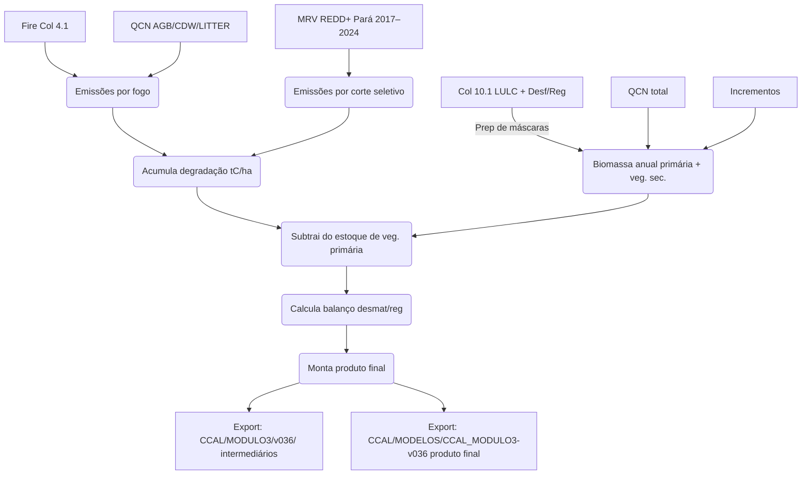

/**** Start of imports. If edited, may not auto-convert in the playground. ****/
var geometry = 
    /* color: #d63000 */
    /* shown: false */
    ee.Geometry.Polygon(
        [[[-76.54780555077535, 6.702549891783329],
          [-76.54780555077535, -36.49659065368281],
          [-28.735305550775358, -36.49659065368281],
          [-28.735305550775358, 6.702549891783329]]], null, false);
/***** End of imports. If edited, may not auto-convert in the playground. *****/
# CCAL Módulo 3 — v036

A Calculadora de Carbono (CCAL) é uma plataforma desenvolvida e implementada pelo Instituto de Pesquisa Ambiental da Amazônia (IPAM). Seu objetivo é oferecer ferramentas precisas, transparentes e acessíveis para o monitoramento dos estoques de carbono e das emissões de gases de efeito estufa associadas ao desmatamento por corte raso e à degradação da vegetação nativa no Brasil, incluindo os processos de fogo e corte seletivo.

A plataforma CCAL é composta por 4 módulos metodológicos principais, que reúnem dados de satélite e equações teóricas robustas para diferentes cenários de transições da cobertura e do uso da terra e bases de carbono nos compartimentos da biomassa (acima do solo, abaixo do solo, madeira morta e serrapilheira):

- **Módulo de Dano Climático**: Desenvolvido para apoiar o Poder Judiciário, estima o valor do dano causado até a data atual descontando o carbono pretérito de uma ação de desmatamento.
- **Módulo 1 (FREL/MRV)**: Gera dados de estoques e emissões de carbono alinhados estritamente com as metodologias oficiais submetidas pelo Brasil à UNFCCC (*Forest Reference Emission Level*).
- **Módulo 2 (FREL Adaptado)**: Expande a metodologia do Módulo 1 ao incluir, além das florestas primárias, as emissões geradas pela passagem do fogo em ecossistemas de savana.
- **Módulo 3 (QCN/MapBiomas)**: Segue mapas e abordagens metodologicas utilizadas por diferentes grupos e parceiros do IPAM, com o que há de mais atual na pesquisa e monitoramento dos estoques carbono, emissões, fogo, degradação e transições de uso e cobertura da terra e seus efeitos para a sociedades.

O foco desta documentação é detalhar o **Módulo 3**. Seu papel é gerar de forma modular e clara os mapas anuais de estoque e as emissões/remoções líquidas de carbono por tipo de distúrbio para alimentar a calculadora.

Para atingir esse objetivo, o pipeline operacional é dividido nas seguintes partes:

## 1. Introdução e Contexto

O **Módulo 3** da plataforma CCAL (Calculadora de Carbono) adota uma abordagem metodológica inovadora, alinhada com o histórico de cobertura da terra e regime de fogo do **MapBiomas** e corte seletivo para o **DETER Amazônia** (2017-2024).

Diferente das estimativas convencionais, o Módulo 3 possui duas características exclusivas:
1. **Considera toda a vegetação nativa** mapeada (Florestas, Savanas e Campos), não se restringindo apenas às fitofisionomias oficiais submetidas no contexto da UNFCCC.
2. **Contabiliza a regeneração** da vegetação secundária, calculando não apenas as emissões brutas, mas também as remoções líquidas de carbono promovidas pelo crescimento de áreas em recuperação.

## 2. Fundamentos Teóricos: Conservação de Massa e Atualização Dinâmica

A base do Módulo 3 é a **Atualização Dinâmica Anual do Estoque de Carbono**. 

Em vez de descontar a degradação de forma estática apenas na área primária do último ano da série, o algoritmo atualiza pixel a pixel toda a cobertura ao longo do tempo. 
A equação de transição base é:

**`Estoque no Ano X = [Vegetação Primária (Estoque Inicial descontando fogo, corte seletivo e corte raso)] + [Vegetação Secundária (remoção anual por incremento)]`**

### O Algoritmo de Balanço e a Prevenção da "Dupla Contagem"
Um dos maiores desafios na contabilização de carbono é lidar com áreas degradadas (por fogo ou corte seletivo) que, anos depois, vêm a ser completamente desmatadas (corte raso).

No Módulo 3, o estoque emitido pela degradação é descontado ativamente **antes** de qualquer evento de desmatamento.
- **Se um pixel foi alvo de fogo no passado**: Parte da sua biomassa foi convertida em emissão.
- **Se ocorre o corte raso hoje**: O modelo calcula a perda associada ao desmatamento baseando-se apenas no **estoque de carbono remanescente** naquele pixel.
Isso garante precisão técnica, evitando contabilizar a mesma árvore como emissão de incêndio e, anos depois, como emissão de desmatamento.

---

## 3. Dinâmicas de Emissão e Remoção

A mecânica do Módulo 3 é segmentada pelos principais processos de distúrbio e ganho:

### A. Vegetação Secundária (Regeneração e Remoções)
Quando o MapBiomas indica áreas de transição que configuram vegetação secundária (regeneração), o modelo injeta acúmulo de carbono ano a ano.
- As taxas de incremento (tC/ha/ano) variam de acordo com o **Bioma** e o **Tipo de Vegetação** (Florestal ou Campestre).
- Há uma distinção matemática de crescimento entre florestas jovens (menos de 20 anos) e florestas em estágios mais maduros (acima de 20 anos).
- O limite máximo de crescimento de um pixel nunca ultrapassa o teto do estoque primário original daquela mesma região.

### B. Emissões por Fogo em Florestas
Em áreas de cobertura florestal, o fogo gera danos severos e prolongados. O modelo não contabiliza apenas as emissões imediatas, mas divide as emissões em duas etapas:
1. **Emissões Imediatas (Não-CO₂)**: Queima instantânea de serrapilheira e madeira morta no solo, liberando altas concentrações de Metano (CH₄) e Óxido Nitroso (N₂O).
2. **Emissões Tardias (CO₂)**: Árvores maiores não queimam instantaneamente, mas podem morrer posteriormente devido aos danos térmicos. Seus troncos apodrecem ao longo dos anos ou décadas subsequentes. O modelo aplica uma curva de decaimento para descontar essa emissão tardia do balanço final de carbono de maneira diluída no tempo.

### C. Emissões por Fogo em Savanas
As dinâmicas de savana e campo evoluíram sob o estresse do fogo, possuindo alta resiliência.
- **Savanas**: Utiliza o *Índice de Intervalo de Retorno do Fogo (FRI)* e o *Tempo Após o Fogo (TSF: time since fire)*. Dependendo da recorrência, o fogo no Cerrado pode levar a pequenos ganhos estruturais pós-recuperação (+2.1%) ou perdas progressivas de biomassa (-0.4% a -2.0% AGB). Para o cálculo de queima instantânea, assume-se que 26% da biomassa acima do solo atua como material combustível fino (componente herbáceo vivo). Atualmente savanas primárias queimadas ao menos uma vez são consideradas como degradadas. Esse é um ponto de atenção pois o fogo em savanas no cerrado não é um processo destrutivo, mas sim um componente natural do bioma.

### D. Emissões por Fogo em Campos
- **Campos**: O balanço de longo prazo de carbono (CO₂) é considerado **neutro**, visto que a biomassa herbácea das gramíneas se recupera quase integralmente após o fogo. Logo, as emissões contabilizadas nestes pixels são apenas as instantâneas (CH₄, N₂O), sem mapear a área como estruturalmente degradada a longo prazo.

### E. Emissões por Corte Seletivo
Aplicável restritamente à Amazônia, onde o impacto da exploração madeireira legal ou ilegal altera permanentemente o estoque. Baseia-se em vetores do DETER AMAZÔNIA (2017-2024), estabelecendo uma fração média de perda (ex: 19.6%) extraída do dossel florestal por hectare afetado nas classes de vegetação florestal com alertas de corte seletivo.


## Estrutura de Arquivos

```text
users/workspaceipam/CCAL:MODULO3/v036/
├── readme.md                    ← este arquivo (documentação geral)
├── unified_modulo3_v036.js      ← SCRIPT UNIFICADO RECOMENDADO
├── toExport_modulo3.js          ← (Alternativo) script de execução modular
└── equations/                   ← (Alternativo) funções modulares separadas
    ├── 01_secondary_veg.js   
    ├── 02_fire_forest.js     
    ├── 03_fire_savanna.js    
    ├── 04_fire_grassland.js  
    └── 05_logging.js         
```

O script `unified_modulo3_v036.js` é a forma mais simples de uso e leitura completa dessa versão do modulo:
- Contém todas as lógicas teóricas como funções puras no final do código.
- Centraliza o comando em um só lugar.
- Permite testar/exportar diferentes partes do modelo simplesmente mudando o valor da chave `active_export_key`.

Os scripts em `equations` são(serão) inspirados no `unified_modulo3_v036.js` e são(serão) modulos com as funções de forma abstrata e descolada do uso de variáveis globais para facilitar a manutenção, leitura e aplicabilidade em diferentes versões do Módulo 3 da CCAL e outros projetos do IPAM e parceiros. O arquivo `toExport_modulo3.js` é um exemplo de como usar as funções de forma modular, separando por partes, importando cada função separadamente e centralizando o comando em um só lugar.


## Datasets de Entrada

| Dataset | Asset GEE / Informações |
| :--- | :--- |
| **MapBiomas LULC Col 10.1** | `projects/mapbiomas-public/assets/brazil/lulc/collection10_1/mapbiomas_brazil_collection10_1_coverage_v1`<br>Bandas: `classification_1985` … `classification_2024` |
| **MapBiomas Desf/Veg Sec Col 10.1** | `projects/mapbiomas-public/assets/brazil/lulc/collection10_1/mapbiomas_brazil_collection10_1_deforestation_secondary_vegetation_v3`<br>Bandas: `classification_1985` … `classification_2024`<br>Classes: 1=Antrópico, 2=Veg.Primária, 3=Veg.Sec., 4=Supressão Prim., 5=Regrowth Sec., 6=Supressão Sec., 7=Outra Transição |
| **QCN Retificada (estoques de carbono)** | `projects/ee-ipam/assets/SEEG/SEEG13/RETIFICACAO/c_rect_col10`<br>Bandas: AGB, BGB, CDW, LITTER, TOTAL (tC/ha) |
| **MapBiomas Fire Col 4.1** | `projects/mapbiomas-public/assets/brazil/fire/collection4_1/` `mapbiomas_fire_collection41_annual_burned_v1`, `fire_frequency_v1`, `time_after_fire_v1`, `accumulated_burned_v1`<br>Bandas: `burned_area_1985` … `burned_area_2024` |
| **Atividade corte seletivo DETER 2017–2024** | `projects/ee-ipam/assets/MRV_REDD_PARA/0_Activity_Year/`<br>`degradation_YYYY_sl_disordered`<br>`degradation_YYYY_sl_geometric` |
| **Tabela de incrementos (veg. secundária)** | `projects/ee-ipam/assets/CCAL/incrementos_modulo3`<br>FeatureCollection: Bioma, Classe (F/G), Ctotal_ate20, Ctotal_mais20 (tC/ha/ano) |
| **Biomas IBGE 250mil** | `projects/mapbiomas-workspace/AUXILIAR/biomas_IBGE_250mil` |


## Lógica da Máscara de Vegetação Estável (nova em v036)

Mapa das classes para o mapa de desmatamento e vegetação secundária do MapBiomas Col 10.1:
1 = Antrópico
2 = Vegetação Primária
3 = Vegetação Secundária
4 = Supressão de vegetação primária.
5 = Recrescimento de vegetação secundária.
6 = Supressão de vegetação secundária.
7 = Outra Transição
8 = Ruído


Combinado com o LULC para saber o TIPO de cobertura:
- `forest_mask` → `desf_reg == 2` AND `lulc == 3` (Formação Florestal)
- `savanna_mask` → `desf_reg == 2` AND `lulc == 4` (Formação Savânica)
- `grassland_mask` → `desf_reg == 2` AND `lulc IN [11, 12, 50]`

A classe 7 (Outra Transição) no dado `desf_reg` é corrigida:
- Substituída pelo valor da ultima observação válida ao olhar para o passado.
- Para os anos iniciais ou sem observação válida ao olhar para o passado, usa-se o valor da primeira observação válida ao olhar para o futuro.


## Saídas — Produto Final (`CCAL_MODULO3-v036`)

Asset: `projects/ee-ipam/assets/CCAL/MODELOS/CCAL_MODULO3-v036`  
Resolução: 30m, float32, pyramidingPolicy: median

| Banda | Unidade | Descrição |
| :--- | :--- | :--- |
| `loss_fire_YYYY` (1986–2024) | tCO₂e/pixel | Emissões por fogo (floresta + savana) × área do pixel |
| `loss_selective_logging_YYYY` (2017–2024) | tCO₂e/pixel | Emissões por corte seletivo × área do pixel |
| `loss_convergence_degradation_YYYY` (1986–2024) | tCO₂e/pixel | Fogo + corte seletivo × área do pixel |
| `gain_secondary_vegetation_YYYY` (1986–2024) | tCO₂e/pixel (negativo) | Remoção por regeneração × área do pixel |
| `loss_grassland_YYYY` (1986–2024) | tCO₂e/pixel | Emissões não-CO₂ por fogo em campos × área do pixel |
| `loss_deforestation_YYYY` (1986–2024) | tCO₂e/pixel | Emissões por supressão × área do pixel |
| `stock_YYYY` (1986–2024) | tC/ha (densidade) | Estoque de C remanescente (após descontos de degr.) |

> ⚠️ **Nota:** Bandas `loss_*` e `gain_*` estão em tCO₂e TOTAL por pixel (×área em ha). A banda `stock_*` está em tC/ha (densidade — NÃO multiplicado pela área).


## Saídas — Assets Intermediários

Pasta: `projects/ee-ipam/assets/CCAL/MODULO3/v036/`

| Asset | Unidade | Bandas |
| :--- | :--- | :--- |
| `biomass_stock_v036` | tC/ha | `biomass_stock_YYYY` |
| `secondary_veg_increment_v036` | tC/ha | `sec_veg_increment_YYYY` |
| `fire_forest_emissions_v036` | tC/ha (CO₂)<br>t/ha (outros) | `CO2_tC_ha_YYYY`<br>`CH4/N2O/CO/NOX_t_ha_YYYY` |
| `fire_savanna_emissions_v036` | tCO₂e/ha (CO₂)<br>t/ha (outros) | `CO2_tCO2e_ha_YYYY`<br>`CH4/N2O/CO/NOX_t_ha_YYYY` |
| `fire_grassland_emissions_v036` | t/ha | `CO/CH4/N2O/NOX_t_ha_YYYY` |
| `logging_emissions_v036` | tC/ha | `logging_tC_ha_YYYY` (Amazônia, 2017–2024) |

> ⚠️ **Nota:** Todos os intermediários estão em DENSIDADE (por hectare), nunca em total por pixel. A conversão para total ocorre APENAS no script, no asset .


## Fluxo Resumido




## Conversões e Constantes

- **tC → tCO₂:** × 3.67 (razão de massas moleculares CO₂/C)
- **GWP CH₄:** × 28 (AR5, 100 anos)
- **GWP N₂O:** × 265 (AR5, 100 anos)
- **tC/ha → kg:** × 1000 (apenas para cálculo de fatores de emissão)
- **m² → ha:** ÷ 10000 (`ee.Image.pixelArea()`)
- **g → Mg (t):** ÷ 1e6


## Contato e Referências

**Equipe CCAL — IPAM Amazônia**
Wallace Silva, Bárbara Zimbres, Manuela Padilha, Celso Silva Junior, Camila Silva, Aline Pontes, Edriano Souza, Livia Laureto, Paulo Moutinho, Ane Alencar

**Modelos de emissão:**
- FATE v2-1: Camila Silva, Aline Pontes, Wallace Silva
- Savanas / Campos: baseado em IPCC 2006 Guidelines, Volume 4
- Corte seletivo: MRV REDD+ Pará / IPAM

**Dados de entrada:**
- MapBiomas LULC: [mapbiomas.org](https://mapbiomas.org)
- MapBiomas Fire: [mapbiomas.org/fogo](https://mapbiomas.org/fogo)
- QCN Retificada: MCTI / IPAM
